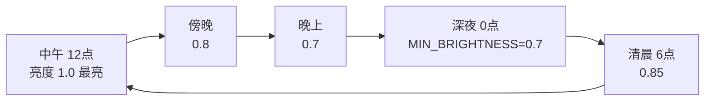

# 美术设计（Season Switch）

> 本文件描述 Season Switch 的**视觉与氛围设计**——颜色、形状、动效与明暗。
> 所有数值均与当前实现一致（见 `elements.json`、`SEASON_TINTS`、`INTENSITY_MAP`、各 `envir` 模块）。
> 架构层面的说明请见 [`design.md`](./design.md)。

## 1. 设计原则

- **克制**：氛围只是"给浏览网页时一点点舒适感"，不能抢内容。色调层透明度上限仅 `0.15`，整体偏淡。
- **季节感来自色与形**：用最低成本唤起季节联想——春的嫩绿小叶、夏的金光与炫光、秋的金黄枯叶、冬的朦胧白球。
- **时间是另一根情绪轴**：用整体亮度模拟"天光"，中午最亮、深夜最暗但不伤阅读。
- **粒子不堆积**：飘落粒子落到窗口底部即停下并缓慢渐隐，不越积越高，保持画面轻盈。

## 2. 季节色调（整页淡淡的色彩覆盖层）

页面最底层是一层跟随季节权重混合的半透明色，营造"空气里的颜色"。

| 季节 | 颜色 (RGB) | 观感 |
| --- | --- | --- |
| 春 | `(120, 200, 100)` | 朦胧的嫩绿 |
| 夏 | `(255, 220, 100)` | 略带金黄的阳光 |
| 秋 | `(220, 180, 60)` | 秋日的暖黄 |
| 冬 | `(200, 210, 230)` | 淡蓝白 |

季节之间按月份做权重插值（见 `season-weights.ts`），例如 3 月是"春 0.7 + 夏 0.3"，12 月是"冬 0.95 + 春 0.05"，交界的 1 月、12 月也自然过渡，不会突变。
透明度 = `min(0.15, 0.04 × 显示程度)`——显示程度越高，空气里的颜色越浓。

## 3. 时间亮度（整页明暗）

- 预设时段：清晨 `0.85`、上午 `0.95`、中午 `1.0`、下午 `0.95`、傍晚 `0.8`、晚上 `0.7`、深夜 `0.7`（`MIN_BRIGHTNESS`，下限保证可读）。
- 自定义 / 跟随系统：以"12 点=1.0、0 点=MIN_BRIGHTNESS"做余弦平滑插值。
- 实现方式：一层黑色遮罩，亮度越低遮罩越不透明（`1 - timeBrightness`）。该层位于色调层之上、粒子层之下，所以粒子始终清晰。
- **特例**：夏季镜头炫光仅在白天（`6–18` 点）且夏权重 > `0.3` 时显示。

## 4. 粒子外观

统一走 `renderer.drawParticle`：内置元素用 `elements.json` 里记录的 SVG 路径绘制（经纬归一到 `[-1,1]` 再按 `size` 缩放），保证形状精致；用户自建的 emoji 元素则用自选字形绘制。

### 4.1 叶子（leaf，fall）

- **形状**：一片柳叶状——`M0,-1 C0.6,-0.3 0.6,0.3 0,1 C-0.6,0.3 -0.6,-0.3 0,-1 Z`，中心一道叶脉 `M0,-0.7 L0,0.7`（半透明描边）。
- **尺寸**：`sizeRange = 4–10 px`（中等时整体缩放系数 1.0；小 0.6×、大 1.5×、自定义 0–100%）。
- **颜色（按季节取色，加权随机）**：
  - 春：`#8FBC8F #90EE90 #7CCD7C #98FB98 #66CD66`（嫩绿）
  - 夏：`#2E8B57 #3CB371 #228B22`（深绿，呼应"夏日清凉"）
  - 秋：`#DAA520 #FFD700 #FF8C00 #D2691E #8B4513`（金黄到枯黄，呼应"落叶里有枯黄色"）
- **动效**：下落 + 左右摆动 + 缓慢旋转，落到窗口底部渐隐；速度与摆动幅度随元素的取值范围随机，自然不整齐。

### 4.2 雪花（snow，fall）

- **形状**：球状——一个圆 `A1,1 … Z`，填充**径向渐变**：中心 `rgba(255,255,255,0.9)` → `0.4` 处 `rgba(255,255,255,0.5)` → 边缘 `rgba(255,255,255,0)`，即"内白外朦胧"。
- **颜色**：固定 `#FFFFFF`。
- **尺寸**：`sizeRange = 3–10 px`；动效比叶子更慢、摆动更轻，几乎不旋转，突出"静谧飘落"。

### 4.3 星光（star，twinkle）

- **形状**：与雪花相同的圆 + 径向渐变，但颜色换成**黄白色**：中心 `rgba(255,250,220,1.0)` → `0.4` 处 `rgba(255,240,180,0.6)` → 边缘 `rgba(255,235,150,0)`，由内到外慢慢朦胧。
- **位置**：屏幕上方 1/3 区域（`target.region = top-third`）。
- **动效**：静止不动，靠 `sin` 波调制透明度一闪一闪（`0.4 + 0.6 × (0.5 + 0.5 × sin(phase))`）。
- **数量时段**：`19:00–次日 5:00` 显示；以午夜为峰值（默认 60 颗），入夜/黎明保留约 25% 数量下限，所以"一入夜就有星星"，而非 19 点整一颗都没有。
- **尺寸**：`sizeRange = 1–3 px`（比雪花更小巧）。
- **与显示程度相关**：绘制透明度与 `intensity` 挂钩（上限 1.5×）。

## 5. 夏季镜头炫光（halo）

右上区域的暖色光晕：`radial-gradient(circle, rgba(255,255,200,0.25) 0%, rgba(255,240,150,0.08) 35%, transparent 70%)`，`blur(15px)`，柔和漂浮感。
透明度 = `夏权重 × 显示程度 × 0.6`，夏意越浓、显示程度越高越明显；非白天或非夏季时直接移除。

## 6. 显示程度

显示程度（朦朦 0.4 / 浅 0.7 / 中 1.0 / 深 1.4 / 自定义 0–100%）是"浓度总开关"：

- 同时放大色调层透明度与粒子绘制透明度（上限 1.5×）；
- 影响星光的最大数量与可见度；
- 影响夏季光晕强度。

即"程度越高，氛围越浓"，但始终保持克制，不遮挡网页内容。

## 7. 自定义元素的美术约定

新增元素只需在 `elements.json` 写清外观，无需改代码：

- `fall` 元素：提供 `seasons` 与（可选）`palettes` 取色，给出 `sizeRange / speedRange / wobble* / rotation* / opacityRange`。
- `twinkle` 元素：给出 `target`（含 `visibleFrom/visibleTo/region/max`）与 `twinkleSpeedRange`，`speedRange` 留 `0`。
- `render.type`：`svg` 用 `paths[]`（每径 `fill`/`stroke`）绘制精致图形；`emoji` 用 `glyph` 直接绘字形（用户自选）。
