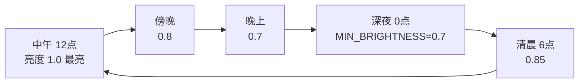

# 美术设计（Season Switch）

> 本文件描述 Season Switch 的**视觉与氛围设计**——颜色、形状、动效与明暗。
> 所有数值均与当前实现一致（见 `elements.json`、`lib/season-weights.ts`、各 `envir` 模块）。
> 架构层面的说明请见 [`design.md`](./design.md)，界面见 [`page.md`](./page.md)。

## 1. 设计原则

- **克制**：氛围只是"给浏览网页时一点点舒适感"，不能抢内容。色调层透明度上限仅 `0.15`，整体偏淡。
- **季节感来自色与形**：用最低成本唤起季节联想——春的嫩绿小叶、夏的金光与炫光、秋的金黄枯叶、冬的朦胧白球。
- **时间是另一根情绪轴**：用整体亮度模拟"天光"，中午最亮、深夜最暗但不伤阅读。
- **粒子不堆积**：飘落粒子落到窗口底部即停下并缓慢渐隐，不越积越高，保持画面轻盈。
- **形状优先于贴图**：内置元素全部是矢量路径，任意尺寸都清晰；用户导入的图片会按高度等比绘制，不会糊。

## 2. 季节色调（整页淡淡的色彩覆盖层）

页面最底层是一层跟随季节权重混合的半透明色，营造"空气里的颜色"。

| 季节 | 颜色 (RGB) | 观感 |
| --- | --- | --- |
| 春 | `(120, 200, 100)` | 朦胧的嫩绿 |
| 夏 | `(255, 220, 100)` | 略带金黄的阳光 |
| 秋 | `(220, 180, 60)` | 秋日的暖黄 |
| 冬 | `(200, 210, 230)` | 淡蓝白 |

季节之间按月份做权重插值（见 `season-weights.ts`），例如 3 月是"春 0.7 + 夏 0.3"，12 月是"冬 0.95 + 春 0.05"，交界的 1 月、12 月也自然过渡，不会突变。
透明度 = `min(0.15, 0.04 × 显示程度)`——显示程度越高，空气里的颜色越浓。

## 3. 时间亮度（整页明暗）



- 预设时段：清晨 `0.85`、上午 `0.95`、中午 `1.0`、下午 `0.95`、傍晚 `0.8`、晚上 `0.7`、深夜 `0.7`（`MIN_BRIGHTNESS`，下限保证可读）。
- 自定义 / 跟随系统：以"12 点 = 1.0、0 点 = MIN_BRIGHTNESS"做余弦平滑插值。
- 实现方式：一层黑色遮罩，亮度越低遮罩越不透明（`1 - timeBrightness`）。该层位于色调层之上、粒子层之下，所以粒子始终清晰。
- **特例**：夏季镜头炫光仅在白天（`6–18` 点）且夏权重 > `0.3` 时显示。

## 4. 粒子外观

四种外观走同一个绘制入口 `renderer.drawParticle`：

| 外观 | 绘制方式 | 尺寸含义 |
| --- | --- | --- |
| `svg` | `Path2D` 路径，坐标在 `[-1, 1]` 空间，按 `size` 缩放 | `size` = 图形的外接尺寸 |
| `image` | `drawImage`，等比缩放 | `size` = 高度，宽度 = `size × aspect`（夹在 `0.1 ~ 10`） |
| `emoji` | `fillText` 绘制字形 | `size` = 字号 |
| `text` | `fillText` + 指定字体字重颜色 | `size` = 字号 |

三种约定对所有外观都成立：

- **居中绘制**：`(x, y)` 是图形中心，不是左上角。
- **可旋转**：`rotation`（弧度）对四种外观都生效，内置与自定义元素一致。
- **描边不随缩放变粗**：SVG 路径的 `stroke.widthPx` 是"20px 渲染尺寸下的视觉像素宽"，实际线宽按 `widthPx / (size × scale)` 反算，所以放大粒子时描边仍是视觉上的细线。

颜色只有一个概念：**粒子色**。路径填充声明 `source: 'particle'` 时用当前粒子色（内置叶子就是靠它按季节变色），`source: 'constant'` 时用路径自带的固定色（导入的 SVG 保留原色）。

### 4.1 叶子（leaf，fall）

- **形状**：一片柳叶状——`M0,-1 C0.6,-0.3 0.6,0.3 0,1 C-0.6,0.3 -0.6,-0.3 0,-1 Z`，中心一道叶脉 `M0,-0.7 L0,0.7`（`rgba(0,0,0,0.12)` 半透明描边，`widthPx = 0.5`）。
- **尺寸**：小 `4px` / 中 `7px` / 大 `10px`（默认 `7px`），可直接拖到 `1 ~ 120px`。
- **颜色（按季节取色，加权随机）**：
  - 春：`#8FBC8F #90EE90 #7CCD7C #98FB98 #66CD66`（嫩绿）
  - 夏：`#2E8B57 #3CB371 #228B22`（深绿，呼应"夏日清凉"）
  - 秋：`#DAA520 #FFD700 #FF8C00 #D2691E #8B4513`（金黄到枯黄，呼应"落叶里有枯黄色"）
  - 只有叶子按季节取色；其他元素只用"季节"决定出不出场。
- **运动参数**：抖动 `0.4`、摆动频率 `1.4`、摆幅 `27px`、旋转速度 `0.75 rad/s`、不透明度 `0.75`。
- **默认值**：速度 `28 px/s`、大小 `7px`、数目 `50 个/分钟`；档位速度 `14 / 28 / 50 px/s`，档位数目 `10 / 20 / 50 / 120`。
- **动效**：下落 + 左右摆动 + 缓慢旋转，落到窗口底部渐隐；速度与幅度带随机抖动，所以不会整齐划一。

### 4.2 雪花（snow，fall）

- **形状**：球状——一个圆 `M-1,0 A1,1 0 1,0 1,0 A1,1 0 1,0 -1,0 Z`，填充**径向渐变**：中心 `rgba(255,255,255,0.9)` → `0.4` 处 `rgba(255,255,255,0.5)` → 边缘 `rgba(255,255,255,0)`，即"内白外朦胧"。
- **颜色**：固定 `#FFFFFF`。
- **尺寸**：小 `4px` / 中 `6.5px` / 大 `10px`（默认 `6.5px`）。
- **运动参数**：抖动 `0.45`、摆动频率 `0.8`、摆幅 `20px`、旋转速度 `0`（不旋转）、不透明度 `0.65`——比叶子更慢、摆动更轻，突出"静谧飘落"。
- **默认值**：速度 `20 px/s`、大小 `6.5px`、数目 `50 个/分钟`；档位速度 `10 / 20 / 36 px/s`。

### 4.3 星光（star，twinkle）

- **形状**：与雪花相同的圆 + 径向渐变，但颜色换成**黄白色**：中心 `rgba(255,250,220,1.0)` → `0.4` 处 `rgba(255,240,180,0.6)` → 边缘 `rgba(255,235,150,0)`，由内到外慢慢朦胧。
- **位置**：屏幕上方 1/3 区域（`target.region = top-third`）。
- **动效**：静止不动，靠 `sin` 波调制透明度一闪一闪（`0.4 + 0.6 × (0.5 + 0.5 × sin(phase))`），闪烁频率 `1.9`。
- **数量时段**：`19:00 – 次日 5:00` 显示；以午夜为峰值（默认 `60` 颗），入夜 / 黎明保留约 `25%` 数量下限（`TWINKLE_FLOOR = 0.25`），所以"一入夜就有星星"，而非 19 点整一颗都没有。
- **尺寸**：小 `1px` / 中 `2px` / 大 `3px`（默认 `2px`），比雪花更小巧。
- **档位**：无速度档（`speedPresets` 为空数组，界面隐藏速度轴）；数目档位 `15 / 30 / 60 / 120 个`。
- **与显示程度相关**：绘制透明度与 `intensity` 挂钩（上限 `1.5×`）。

## 5. 夏季镜头炫光（halo）

右上区域的暖色光晕：`radial-gradient(circle, rgba(255,255,200,0.25) 0%, rgba(255,240,150,0.08) 35%, transparent 70%)`，`blur(15px)`，柔和漂浮感。
透明度 = `夏权重 × 显示程度 × 0.6`，夏意越浓、显示程度越高越明显；非白天或非夏季时直接移除。

## 6. 显示程度

显示程度（朦朦 `0.4` / 浅 `0.7` / 中 `1.0` / 深 `1.4` / 自定义 `0–100%`）是"浓度总开关"：

- 同时放大色调层透明度与粒子绘制透明度（上限 `1.5×`）；
- 影响星光的最大数量（`峰值数量 × min(显示程度, 1.5)`）与可见度；
- 影响夏季光晕强度。

即"程度越高，氛围越浓"，但始终保持克制，不遮挡网页内容。

## 7. 自定义元素的美术约定

自定义元素可以在管理页里做，也可以手写 JSON 导入。一个元素的完整"美术描述"由四部分组成：外观（`render`）、运动（`motion`）、出现（`seasons` / `target`）、档位（三个 `presets` + `defaults`）。

### 7.1 外观

```jsonc
// 1) 路径：坐标归一化到 [-1,1]，可带 matrix 做导入时的仿射变换
{ "kind": "svg", "paths": [
  { "d": "M0,-1 L1,1 L-1,1 Z",
    "fill": { "mode": "solid", "source": "particle" },
    "stroke": null }
] }

// 2) 图片：assetId 由管理页上传时生成，aspect = 宽/高
{ "kind": "image", "assetId": "a_xxxx", "aspect": 1.5 }

// 3) emoji：单个字形
{ "kind": "emoji", "glyph": "🌸" }

// 4) 文字：字体、字重、颜色都需显式给出
{ "kind": "text", "text": "秋", "fontFamily": "楷体", "fontWeight": 600, "color": "#e6c76a" }
```

- 想"跟着季节变色"就写 `fill.source: "particle"` 并提供 `palettes`；想"保持原样"就写 `source: "constant"` + `color`（导入的 SVG 默认如此）。
- 内置元素的路径都是手写归一化坐标，不需要 `matrix`；`matrix` 只出现在导入 SVG 的元素上。

### 7.2 运动参数

| 字段 | 含义 | 建议区间 | 单位 |
| --- | --- | --- | --- |
| `speed` | 下落速度 | `0 – 200` | px/s |
| `size` | 图形尺寸 | `1 – 120` | px |
| `count` | 数目 | 飘落 `0 – 1800`、闪烁 `0 – 300` | 个/分钟、个 |
| `jitter` | 每颗粒子的随机扰动幅度 | `0 – 1` | — |
| `wobbleSpeed` | 左右摆动频率 | `0 – 5` | — |
| `wobbleAmp` | 左右摆动幅度 | `0 – 80` | px |
| `rotationSpeed` | 自转速度（负值反向） | `−3 – 3` | rad/s |
| `opacity` | 基础不透明度 | `0 – 1` | — |
| `twinkleSpeed` | 闪烁频率（仅闪烁元素） | `0 – 10` | — |

### 7.3 出现

- `fall` 元素：`seasons` 列出参与的季节（春 `spring` / 夏 `summer` / 秋 `autumn` / 冬 `winter`），权重按月份插值，交界月份会"淡入淡出"。
- `twinkle` 元素：`target.region` 取 `top-third`（上三分之一）或 `full`（全屏），`visibleFrom` / `visibleTo` 为小时（可跨午夜）。

### 7.4 档位与默认值

`speedPresets` / `sizePresets` / `countPresets` 各给 3（或多个）常用值，`defaults` 给三根轴的初始值。弹窗里的"慢 / 中 / 快""小 / 中 / 大""微量 / 少量 / 中等 / 大量"就是这些数组的下标——**数组顺序即档位顺序**，缺省时按 `NUMERIC_LIMITS` 夹取。
