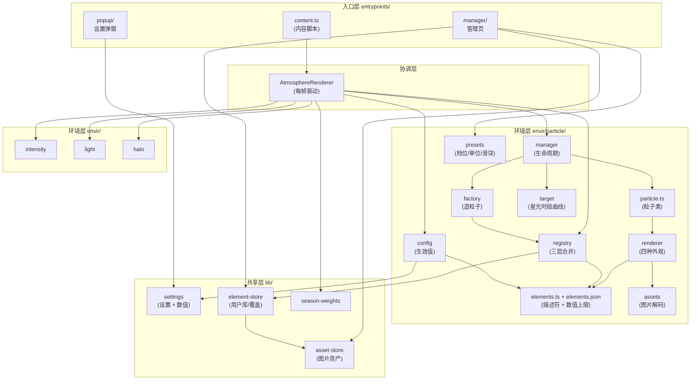
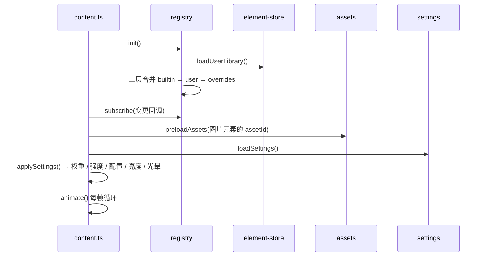
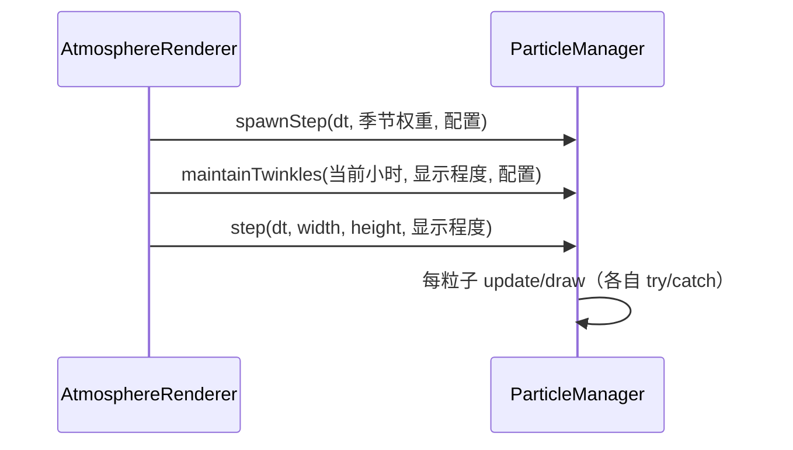

# 设计文档（Season Switch）

> 本文说明本次「粒子数值化 + 用户自定义元素 + 独立管理页」重构后的整体设计（简要）。
> 界面设计见 [`page.md`](./page.md)，美术与观感见 [`art.md`](./art.md)。

## 1. 设计目标

- **四种外观走同一条绘制路径**：SVG 路径、图片、emoji、文字都抽象成一处「外观描述」，渲染器只认 `render` 字段，不关心它是内置元素还是用户自建的。
- **用户可扩展而不改代码**：管理页里造元素、传图、导入导出 JSON，运行期与弹窗自动识别。
- **数值即真相**：速度是 `px/s`、大小是 `px`、数目是「个」或「个/分钟」。档位（慢 / 中 / 快）只是描述符里的一组常用值，不再是数据模型里的枚举。
- **出问题只影响自己**：单个粒子异常不影响其他粒子；越界数值在读取层就被夹住，手改存储或导入 JSON 也不会让粒子瞬间飞出屏幕。

## 2. 分层结构

## 3. 关键模块职责

| 模块 | 职责 |
| --- | --- |
| `entrypoints/content.ts` | 内容脚本入口与协调者：注入三层固定 DOM（色调 / 亮度 / 粒子），`await registry.init()` 后每帧驱动 `spawnStep` / `maintainTwinkles` / `step`，订阅设置与元素库变更。自身不含粒子物理。 |
| `envir/particle/registry.ts` | 元素注册表：内置 → 用户库 → 内置覆盖三层合并，订阅 `chrome.storage.onChanged` 自动重建，对外提供 `list` / `get` / `subscribe` / `isReady`。 |
| `envir/particle/elements.ts` + `elements.json` | 描述符契约与内置数据，另有 `NUMERIC_LIMITS`（全部数值字段的合法区间）与 `clampDescriptor`（越界夹取）。 |
| `envir/particle/presets.ts` | 速度 / 大小 / 数目三根轴的档位标签、单位、步长、滑块上限，以及 `matchPreset`（当前值等于某档 → 点亮该档，否则「自定义」）。 |
| `envir/particle/config.ts` | 把描述符的 `defaults` 与 `settings.particles[id]` 合成「当前生效值」，并再夹一次区间。 |
| `envir/particle/target.ts` | 星光按时段的数量曲线，含 `TWINKLE_FLOOR` 保底。 |
| `envir/particle/factory.ts` | 按描述符造粒子：抖动、随机取色（按季节权重选调色板）、区域落位。 |
| `envir/particle/particle.ts` | 粒子数据类：位置 / 速度 / 相位，外加一个指向 `render` 的指针。 |
| `envir/particle/manager.ts` | 生命周期总控：按元素累加器生成、按时段维持、统一更新与绘制、800 颗硬上限、边界回收、`sync()` 丢弃已失配的在飞粒子、逐粒子故障隔离。 |
| `envir/particle/renderer.ts` | 唯一绘制入口：处理四种外观、仿射矩阵、描边宽度补偿。 |
| `envir/particle/assets.ts` | 图片资产解码与缓存：优先 ``（GIF 会动），被 CSP 拦截时降级 `createImageBitmap`。 |
| `lib/settings.ts` | `Settings` 类型与存储读写；`particles` 为「元素 id → 数值三件套」。 |
| `lib/element-store.ts` | 用户元素库的增删改查、校验、导入导出，以及内置元素的覆盖字段（overrides）。 |
| `lib/asset-store.ts` | 图片以 dataURL 存 `chrome.storage.local`，按内容哈希去重，单张上限 512 KB。 |
| `lib/season-weights.ts` | 月份 → 四季权重插值（3 月 = 春 0.7 + 夏 0.3）。 |
| `envir/intensity` / `light` / `halo` | 显示程度、时段亮度、夏季镜头炫光。 |
| `popup/` | 快速设置弹窗：季节 / 时间 / 显示程度 / 每个元素的三根轴。 |
| `manager/` | 管理页（独立标签页）：新建 / 我的粒子 / 详情，含实时预览与 JSON 导入导出。 |

## 4. 数据模型

### 4.1 三处存储（`chrome.storage.local`）

| 键 | 内容 | 写入方 |
| --- | --- | --- |
| `settings` | 季节 / 时间 / 显示程度 + `particles: Record<元素 id, {speed, size, count}>` | popup、管理页详情页 |
| `userLibrary` | `{ version: 1, elements: 用户元素[], overrides: 内置覆盖 }` | 管理页（新建 / 详情 / 导入） |
| `asset:<id>` | `{ id, mime, dataUrl, bytes, aspect }` | 管理页上传图片 |

`settings.particles` 只存**数值**。旧版本的档位字符串（`'normal'`、`'custom-speed'` 等）会在读取时被判为非数值而丢弃，回落到描述符默认值——不写迁移代码。

### 4.2 元素描述符（`ElementDescriptor`）

| 字段 | 说明 |
| --- | --- |
| `id` / `source` / `label` / `icon` | 唯一标识（用户元素前缀 `u_`）、来源（内置 / 用户）、显示名、列表图标 |
| `behavior` | `fall` 飘落 / `twinkle` 闪烁 |
| `seasons` | 参与哪些季节；空数组表示全年（星光即如此） |
| `render` | 外观，四种之一（见 4.3） |
| `color` | 固定颜色，颜色选择器作用于此 |
| `palettes` | 按季节权重取色的色板（内置叶子用；用户元素可选） |
| `speedPresets` / `sizePresets` / `countPresets` | 三根轴的常用值（也是弹窗档位按钮的值） |
| `motion` | `jitter` / `wobbleSpeed` / `wobbleAmp` / `rotationSpeed` / `opacity` / `twinkleSpeed` |
| `target` | 仅闪烁元素：`region`（上三分之一 / 全屏）+ `visibleFrom` / `visibleTo` 小时 |
| `defaults` | 默认 `speed` / `size` / `count`，新建元素时的初始值 |

### 4.3 四种外观

- `{ kind: 'svg', paths: [{ d, fill, stroke, matrix? }] }`：路径在 `[-1, 1]` 归一化空间绘制；`fill` 可为 `{ mode: 'solid', source: 'particle' | 'constant', color? }` 或 `{ mode: 'radial', stops }`；`matrix` 为导入 SVG 时保留的仿射变换。
- `{ kind: 'image', assetId, aspect }`：高度取 `size`，宽度 `size × aspect`（夹在 0.1~10）。
- `{ kind: 'emoji', glyph }`：`fillText`，字号 = `size`。
- `{ kind: 'text', text, fontFamily, fontWeight, color }`：同上，但带字体与颜色。

### 4.4 数值区间（`NUMERIC_LIMITS`）

| 字段 | 区间 | 步长 |
| --- | --- | --- |
| `speed` | 0 – 200 px/s | 1 |
| `size` | 1 – 120 px | 0.5 |
| `count`（飘落） | 0 – 1800 个/分钟 | 1 |
| `count`（闪烁） | 0 – 300 个 | 1 |
| `jitter` | 0 – 1 | 0.01 |
| `wobbleSpeed` | 0 – 5 | 0.1 |
| `wobbleAmp` | 0 – 80 px | 1 |
| `rotationSpeed` | −3 – 3 rad/s | 0.05 |
| `opacity` | 0 – 1 | 0.01 |
| `twinkleSpeed` | 0 – 10 | 0.1 |
| `hour` | 0 – 23 | 1 |
| `aspect` | 0.1 – 10 | 0.1 |

UI 滑块与读取层共用这一份定义：滑块负责不让用户手滑，读取层负责挡住手改存储与导入的 JSON。

## 5. 数据流

### 5.1 启动

### 5.2 变更传播

- **改设置**（popup 或管理页详情）→ `settings` 键变化 → 内容脚本 `applySettings` 重算权重、显示程度、各元素生效值。
- **改元素库**（新建 / 编辑 / 删除 / 导入）→ `userLibrary` 键变化 → `registry.rebuild` → 内容脚本 `sync()` 立即丢弃失配的在飞粒子、补载图片资产（失败的允许重试）、重算配置；管理页与弹窗各取所需。
- **改单元素**（详情页）对用户元素写 `userLibrary.elements`，对内置元素只写 `userLibrary.overrides`，因此内置元素不会被"复制"一份。

### 5.3 每帧

## 6. 关键取舍

| 取舍 | 结论 | 原因 |
| --- | --- | --- |
| 档位枚举 vs 数值 | 以数值为准，档位只是常用值 | 自定义不需要「百分比」这种中间单位；迁移到别的元素/别的机器时 `px/s` 直观；管理页滑块直接编辑真实数值 |
| 用户库存放位置 | `chrome.storage.local` + JSON 导入导出 | 打包内的 `elements.json` 是只读资源，运行期不可写；storage 在 `unlimitedStorage` 下足够放图片 |
| 三层合并 | 内置 → 用户 → 覆盖 | 内置元素不可删但可改；覆盖只存与模板不同的字段，内置模板升级后仍能继承新值 |
| SVG 导入方式 | 保留原始 `d`，另附仿射矩阵（`ctx.transform`） | 不引入 `svgpath` 之类的解析依赖（当前环境装不了新包），且弧线、椭圆、旋转都是精确变换而非数值近似 |
| 图片解码 | 先 ``，失败再 `createImageBitmap` | `` 支持 GIF 动画；严格 CSP 站点拦下内联 SVG/图片时用位图兜底 |
| 数值夹取位置 | `NUMERIC_LIMITS` 单一来源，UI 与读取层共用 | 一处改，两边同步；也便于文档与代码对齐 |
| 代码组织 | 每个页面 / 视图独立成文件，允许重复 | 单文件即可看懂一个界面；用户明确要求"模块化、允许代码重复" |

## 7. 特例与注意事项

- **星光（star）是 `twinkle` 行为**：静态不动，没有速度轴（`axisVisible` 返回 `false`），弹窗自动隐藏「速度」；「数目」含义是**峰值颗数**而非「个/分钟」。
- **跨午夜时段**：`visibleFrom = 19`、`visibleTo = 5`。为避免 19:00 整"一颗都没有"，`getTwinkleTarget` 用 `TWINKLE_FLOOR = 0.25` 保底，入夜与黎明都保留约 25% 峰值数量。
- **只有内置叶子按季节取色**：颜色由 `palettes` 按季节权重加权随机；其他元素只用 `seasons` 决定"出不出现"。用户元素同样可以填 `palettes`，但管理页目前没有开放该字段。
- **绘制约定**：SVG 路径在 `[-1, 1]` 空间、按 `size` 缩放；图片高度 = `size`、宽度 = `size × aspect`；emoji / 文字用 `fillText`，字号 = `size`。四种外观都居中绘制，emoji 与文字也支持旋转。
- **描边宽度补偿**：`lineWidth = widthPx / (size × scale)`，粒子放大缩小时描边的视觉粗细保持不变。
- **上限与回收**：飘落粒子硬上限 800 颗（超限淘汰最旧）；飘出左右各 120px 的粒子立即回收，缩窗后不会长期占名额。
- **故障隔离**：`step()` 内每个粒子的更新与绘制各自 `try/catch`，异常只移除该粒子；错误日志按 60 秒时间窗限流（每窗最多 20 条）。
- **图层层级**：色调层 `z-index: 2147483645`，亮度层与夏季炫光 `2147483646`，粒子画布 `2147483647`，保证粒子始终可见。
- **已知限制**：严格 CSP 站点下 GIF 会退化为首帧、内联 SVG 可能解码失败；导出的 JSON **不含**图片资产（`asset:*` 键不在其中），换环境导入后图片元素会静默不显示；管理页预览不参与季节体系，内置叶子预览显示为白色。
