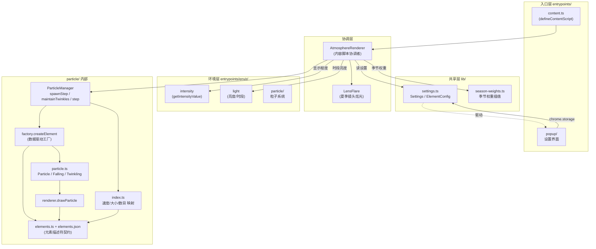
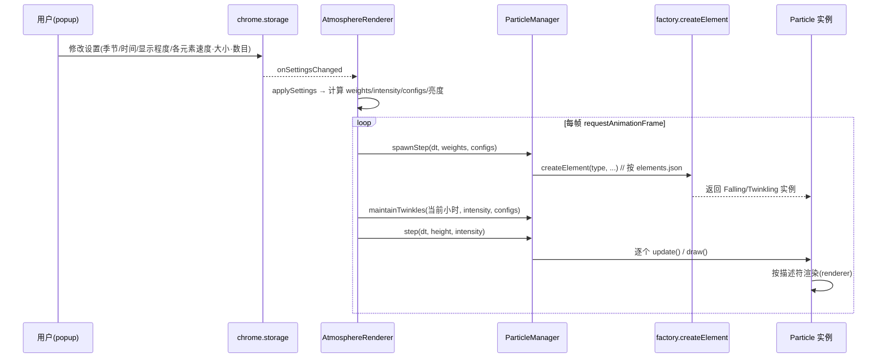

# 设计文档（Season Switch 大重构后）

> 本文档说明 Season Switch 在完成「OOP 重构 + 数据驱动」大改造后的整体设计。
> 美术相关的具体观感请见同目录 [`art.md`](./art.md)。

## 1. 设计目标

- **可插拔**：新增一种氛围元素（如花瓣、雨滴、emoji）只需在 `elements.json` 增加一条数据，运行期与弹窗自动识别，零 TypeScript 改动。
- **高内聚低耦合**：每个粒子自身的属性与行为（下落 / 摆动 / 渐隐 / 闪烁）收归粒子类；生成、统一更新、绘制、消失的生命周期收归 `ParticleManager`。
- **故障隔离**：单个粒子的异常只影响它自己，不会中断渲染循环或波及其他粒子。

## 2. 分层结构

## 3. 关键模块职责

| 模块 | 职责 |
| --- | --- |
| `entrypoints/content.ts` | 内容脚本入口与协调者。创建三层 DOM（色调层 / 亮度层 / 粒子层）与 `LensFlare`，按设置驱动每帧渲染。自身不含粒子物理。 |
| `envir/particle/manager.ts` | 粒子生命周期管理：按元素累加器生成飘落粒子、按时段维持闪烁粒子、统一 `step` 更新+绘制、逐粒子故障隔离。 |
| `envir/particle/factory.ts` | 数据驱动工厂。读 `elements.json` 描述符，按 `behavior` 构造 `FallingParticle` / `TwinklingParticle`，参数全部来自描述符范围。 |
| `envir/particle/elements.ts` + `elements.json` | 元素描述符契约：类型、外观、出现季节、尺寸/速度/闪烁范围、target 时段。新增元素只改 JSON。 |
| `envir/particle/particle.ts` | `Particle` 抽象基类与 `FallingParticle` / `TwinklingParticle` 派生类，封装自身 update/draw。 |
| `envir/particle/renderer.ts` | 统一绘制入口，按描述符用 Path2D 与径向渐变绘制 SVG 元素，或绘 emoji。 |
| `envir/particle/index.ts` | 速度/大小/数目映射与配置聚合（`getElementConfigs`）。 |
| `envir/intensity` / `envir/light` / `envir/halo` | 显示程度、时段亮度、夏季镜头炫光。 |
| `lib/settings.ts` / `lib/season-weights.ts` | 共享设置类型、存储读写；月份→四季权重插值。 |

## 4. 数据流向

## 5. 特例与注意事项

- **星光（star）是 `twinkle` 行为**：静态不动，没有速度项；其"数目"含义为**午夜（峰值）最大数量（个）**，而非飘落元素的"个/分钟"。弹窗对 `twinkle` 元素自动隐藏"速度"控件。
- **星光出现时段跨午夜**：`visibleFrom=19, visibleTo=5`。为避免"刚入夜（19:00）一颗都没有"的观感，`getTwinkleTarget` 设了 `TWINKLE_FLOOR=0.25` 下限——入夜与黎明都会保留约 25% 峰值数量的星光。
- **叶子（leaf）按季节取色**：`elements.json` 中 leaf 的 `palettes` 含春/夏/秋三套色板，生成时按当前季节权重从中加权随机取色；雪花（snow）使用固定白色 `color`。
- **叶子尺寸在数据驱动后统一为 4–10px**：重构前按季节分别 4–8 / 5–9 / 5–10，现合并为单一 `sizeRange`，观感基本一致、更简洁。
- **新增自定义元素零代码**：在 `elements.json` 增加一条即可。必备字段：`behavior`、`label`、`icon`、`render`、`sizeRange`；`fall` 需 `seasons`，`twinkle` 需 `target`。弹窗与运行期均按 `ELEMENT_TYPES`（JSON 键序）自动识别。
- **故障隔离**：`step()` 内每个粒子的 `update`/`draw` 各自独立 `try/catch`，异常仅移除该粒子；错误日志上限 `MAX_ERROR_LOGS=20`，`clear()` 时重置，避免刷屏。生成环节（`spawnStep` / `maintainTwinkles`）对 `createElement` 同样兜底。
- **存储向后兼容**：`Settings.particles` 是 `Record<string, ElementConfig>` 索引签名；旧存储缺少某元素时，`loadSettings` 合并默认配置回退，不会崩溃。
- **图层层级**：色调层 z=2147483645，亮度层与光晕 z=2147483646，粒子层 z=2147483647，保证粒子始终在最上、清晰可见。
